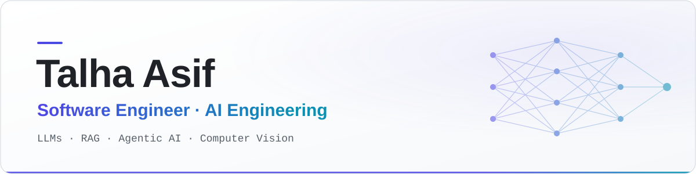

<picture>
  <source media="(prefers-color-scheme: dark)" srcset="./assets/header-dark.svg">
  
</picture>

I build practical AI products: LLM applications, RAG pipelines, agentic workflows and computer vision systems, shipped as full-stack software with FastAPI and React.

 

### Experience

**Associate Software Engineer** · Zones IT Solutions &nbsp; Jun 2026 – Present 
System integration for the Zones Digital Platform: delivering user stories, resolving business issues and validating releases for the ZDP 1.0 MVP and 1.1.

**Full Stack Developer Intern** · WAI Industries &nbsp; Jan – Apr 2026 
Built full-stack features and REST APIs for “Digital Eye” (FBR) with FastAPI, React and Next.js.

**B.S. Artificial Intelligence** · COMSATS University Islamabad &nbsp; 2022 – 2026

 

### Selected projects

**FLEXA** — AI fitness platform 
Personalized workout and diet plans, food calorie detection from photos (ResNet, MobileNet), real-time posture tracking and a bilingual English/Urdu RAG assistant. Built and deployed end to end. 
FastAPI · React · PostgreSQL · PyTorch · scikit-learn · FAISS · MediaPipe · Groq

**[AI Real-Time Canvas](https://github.com/shery-dotcom/AI-Real-Time-Canva)** — LLM-driven collaborative canvas 
Plain-English prompts become shapes on a shared canvas. The model returns a layout plan; the server computes and validates coordinates, then syncs every client over WebSockets. 
TypeScript · React Konva · NestJS · Socket.io · Groq

**Tool-Calling AI Agent** — agentic AI 
Multi-controller agent with contextual memory, fallback handling, web search and RAG, evaluated on the LAMA and GSM8K benchmarks. 
LLMs · Tool calling · RAG

**GIKI Prospectus Q&A** — RAG chatbot 
Answers questions about the GIKI prospectus with context-aware, embedding-based retrieval. 
LLMs · RAG · Embeddings

**Object Detection & Face Identification** — computer vision 
Real-time detection and face recognition, trained on a custom Roboflow dataset. 
YOLOv8 · InsightFace · OpenCV · ONNX Runtime

 

### Stack

| Area | Tools |
| :-- | :-- |
| AI / ML | PyTorch · TensorFlow · scikit-learn · Hugging Face Transformers · OpenCV |
| LLMs | RAG · Agentic AI · LangChain · FAISS |
| Backend | Python · FastAPI · NestJS · PostgreSQL · SQL |
| Frontend | TypeScript · JavaScript · React · Next.js · Tailwind CSS |
| Tooling | Docker · Git |

 

### Focus

- **Agentic AI:** tool-calling agents with memory, fallbacks and retrieval
- **RAG:** assistants that stay grounded in their source documents
- **Applied computer vision:** real-time detection, recognition and pose tracking

 

Reach me on [LinkedIn](https://www.linkedin.com/in/talha-asif-084985248) or at [talhaasif487@gmail.com](mailto:talhaasif487@gmail.com).
